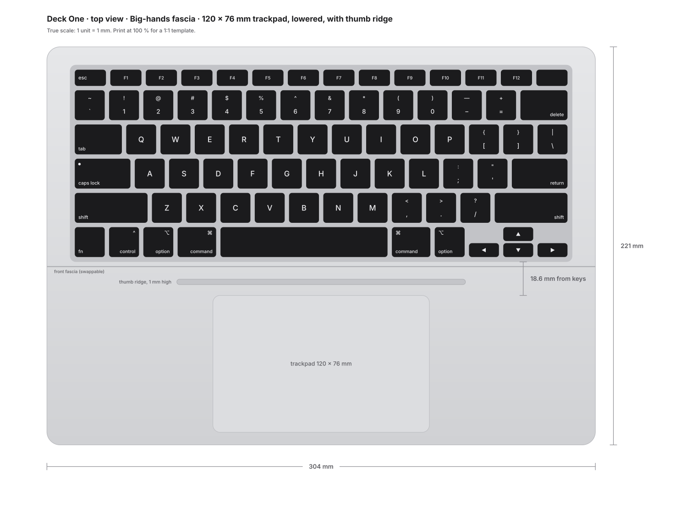
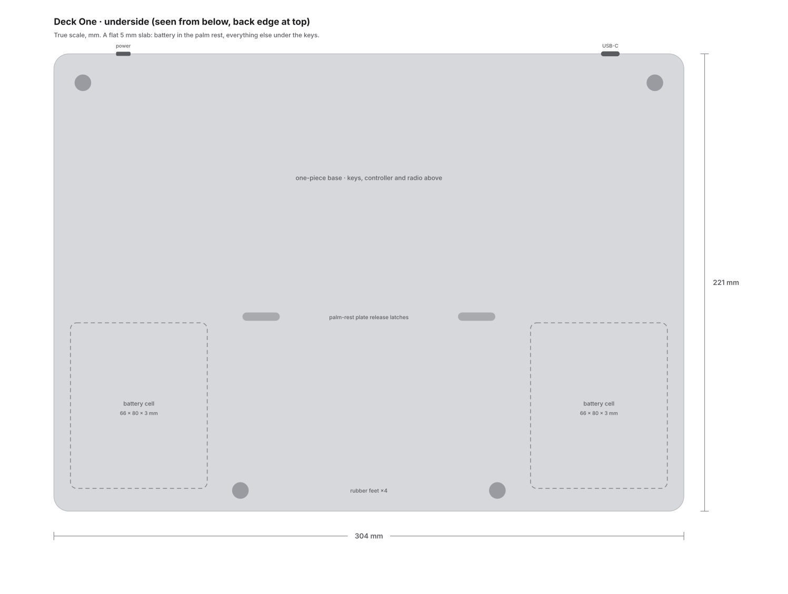
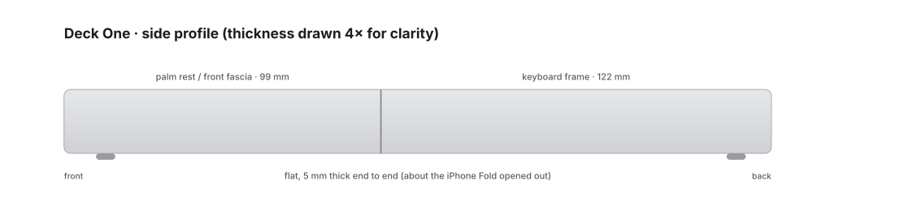

# Deck One

**An open-source keyboard and trackpad in one flat slab: the thin-laptop deck, without the laptop.**


Deck One is a laptop-style keyboard with a trackpad below it, in one aluminium slab **5 mm thick** (about as thin as an iPhone Fold opened out). It has its own battery, connects over Bluetooth or a USB-C cable, and runs open firmware. That's it.

It's modular **only if you want it to be**: the palm rest, trackpad included, is a separate plate you can swap. Take a different trackpad size, no trackpad at all, or a material that copes with sweaty hands.

> **Status:** design concept, free for anyone to build, fork, copy or improve. No product exists yet. All measurements are design targets.

## What it is

- **Keyboard:** the thin-laptop US layout, key for key. Half-height function row with media keys, inverted-T arrows, and a square flush fingerprint key.
- **Trackpad:** 140 × 90 mm glass, centred under the space bar.
- **One flat slab:** 304 × 221 × 5 mm.
- **Battery:** built in, two flat cells under the palm rest.
- **Connection:** Bluetooth to 3 devices, or a USB-C cable for data and charging.
- **Firmware:** open ([ZMK](https://zmk.dev)), so you can remap anything.
- **Looks:** silver aluminium to sit with a Mac mini; other finishes possible.

## Modular, if you want it

The palm rest is a separate top plate, held by two latches underneath. Three versions are drawn:

| Standard | Big hands | Wrist rest |
|---|---|---|
|  |  |  |
| 140 × 90 mm trackpad, 5.3 mm from the keys | 120 × 76 mm trackpad, 18.6 mm from the keys, behind a thumb ridge | no trackpad |

Each comes in aluminium, glass or soft-touch polymer. Big hands keep hitting laptop trackpads, and sweat corrodes aluminium and wears palm rests out, so this is the one part worth making swappable. → [docs/fascia.md](docs/fascia.md)

## Drawings

All drawings are true-scale SVGs (1 unit = 1 mm). Print at 100 % for a 1:1 template.

| Drawing | File |
|---|---|
| Top view, standard palm rest | [`drawings/top-view-standard.svg`](drawings/top-view-standard.svg) |
| Top view, big-hands palm rest | [`drawings/top-view-big-hands.svg`](drawings/top-view-big-hands.svg) |
| Top view, wrist rest | [`drawings/top-view-wrist-rest.svg`](drawings/top-view-wrist-rest.svg) |
| Underside | [`drawings/underside.svg`](drawings/underside.svg) |
| Side profile | [`drawings/side-profile.svg`](drawings/side-profile.svg) |





## Repository layout

```
README.md
docs/
  spec.md             full specification
  keyboard-layout.md  every row, key, unit size and fn combination
  fascia.md           the swappable palm rest, materials, big and sweaty hands
  build-guide.md      prototype one yourself
  design-notes.md     decisions, trade-offs, known limits
drawings/             true-scale SVGs (mm)
images/               PNG previews
data/                 position and size of all 78 keys (JSON, CSV)
tools/                generate_drawings.py: redraws drawings/ and data/
design-canvas/        source of the original design boards
```

To change a dimension, edit the constants at the top of `tools/generate_drawings.py` and run `python3 tools/generate_drawings.py`.

## Known limits

- **5 mm is thin.** It needs a very low-profile scissor keyboard and thin cells, as in a thin laptop. A DIY prototype with off-the-shelf parts will be thicker (about 10–15 mm). See [docs/design-notes.md](docs/design-notes.md).
- **Touch ID** only works with Apple's own keyboards. The fingerprint key works with computers that accept an external reader, and maps to lock screen elsewhere.
- **macOS gestures:** macOS gives full multi-touch gestures to Apple trackpads only; a third-party trackpad usually gets pointer and scrolling. Windows and Linux support multi-touch trackpads natively.

## Contributing

CAD, PCB layouts, firmware configs, new palm-rest plates and prototype photos are all welcome. See [`CONTRIBUTING.md`](CONTRIBUTING.md).

## Licence

MIT: use, copy, modify, build and sell it, as long as the licence and credit stay with it. See [`LICENSE`](LICENSE).

## Credit

Concept and design by **Nithin Yadav Gopinath** ([@nithinyadavg](https://github.com/nithinyadavg) · [nithinyadavg.me](https://nithinyadavg.me)).

*Mac, Mac mini, Touch ID and iPhone are trademarks of Apple Inc. They are mentioned only to describe compatibility and size. This project is not affiliated with or endorsed by Apple.*
