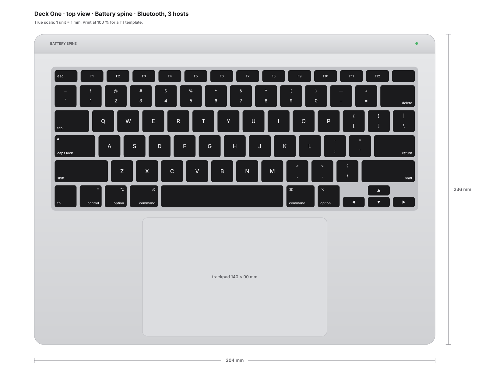
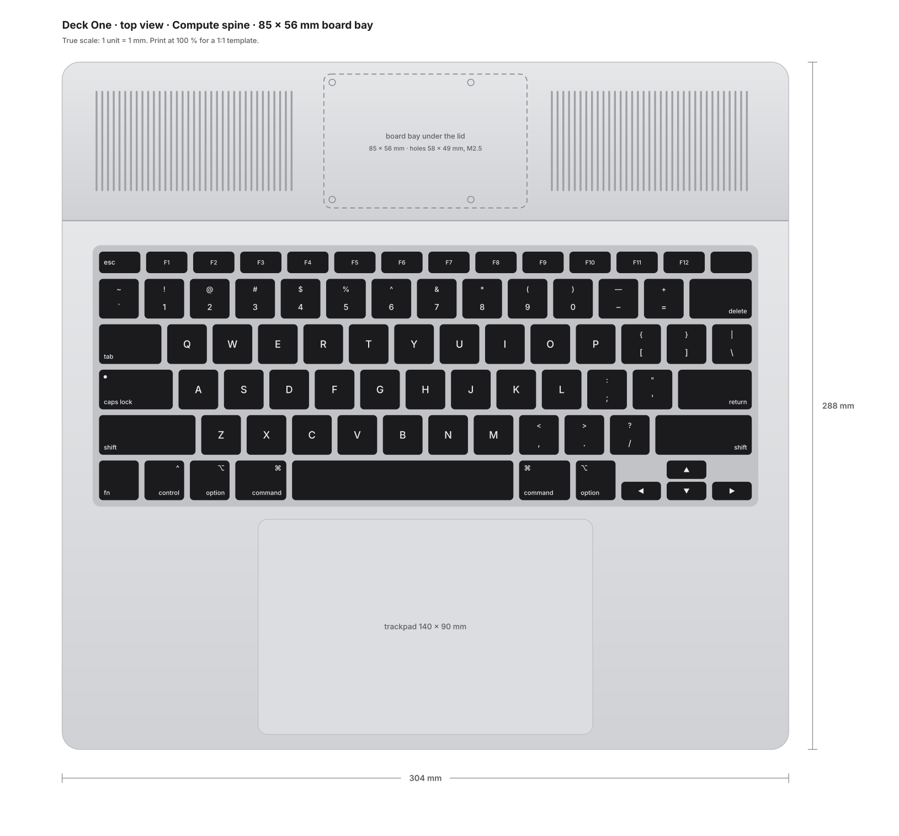
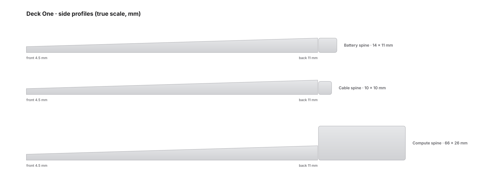

# Deck One

**An open-source concept for a laptop-style keyboard and trackpad deck, built to sit with a Mac mini or to become a computer of its own around a Raspberry Pi–size board.**



Deck One takes the bottom half of a thin laptop (the keyboard with its half-height function row and a proper glass trackpad in the palm rest) and turns it into one light, standalone aluminium slab. A swappable **spine** clips onto the back edge and decides what the deck is:

| Spine | What it does | Depth × height |
|---|---|---|
| **Battery** (in the box) | Built-in battery + Bluetooth, switches between up to 3 hosts | 14 × 11 mm |
| **Cable** (lightest) | No battery, no radio. USB-C to the host plus a USB-C pass-through | 10 × 10 mm |
| **Compute** (for builders) | A bay for an 85 × 56 mm single-board computer on standard 58 × 49 mm M2.5 mounts, with a swappable I/O plate | 66 × 26 mm |

> **Status:** design concept, open to anyone to build, fork or improve. No product exists yet. All measurements are design targets.

---

## Why

- **Desktop computers like the Mac mini have no laptop-style input.** You end up with a keyboard and a separate trackpad that drift apart, sit at different heights and need two batteries.
- **Laptop decks get the layout right**: trackpad centred under your thumbs, palm rest either side, everything at one height. Deck One keeps that and drops the screen.
- **Builders need it too.** Raspberry Pi and other SoC projects usually end up with a cheap keyboard and a cable mess. With the compute spine, the board lives inside the deck.

## Key features

- **Thin-laptop keyboard layout**, key for key: half-height function row with media keys, 1.5-unit tab and delete, 1.75-unit caps lock and return, 2.25-unit shifts, inverted-T arrows with full-width left/right. US layout.
- **Square fingerprint key** at top right: flush, opaque, the same size and finish as the function keys. No ring.
- **140 × 90 mm glass trackpad**, centred under the space bar. Big enough for four-finger gestures and long drags, small enough to keep the deck easy to carry.
- **One slab**: 304 mm wide (the width of a 13-inch laptop), 221 mm deep, tapering from 4.5 mm at the wrists to 11 mm at the back.
- **Magnetic spine connector** along the back edge, carrying power and USB.
- **Weight target:** under 500 g with the battery spine.
- **Finish:** bead-blasted silver aluminium to match a Mac mini; Space Black option.

## Drawings

All drawings are true-scale SVGs (1 unit = 1 mm). Print at 100 % for a 1:1 paper template.

| Drawing | File |
|---|---|
| Top view, battery spine | [`drawings/top-view-battery.svg`](drawings/top-view-battery.svg) |
| Top view, cable spine | [`drawings/top-view-cable.svg`](drawings/top-view-cable.svg) |
| Top view, compute spine | [`drawings/top-view-compute.svg`](drawings/top-view-compute.svg) |
| Side profiles, all spines | [`drawings/side-profile.svg`](drawings/side-profile.svg) |





## Repository layout

```
README.md                  this file
docs/
  spec.md                  full specification and dimensions
  keyboard-layout.md       every row, key and unit size
  modules.md               the three spines and the connector
  build-guide.md           how to prototype one yourself
  design-notes.md          decisions, trade-offs and known limits
  images/                  PNG previews used in this README
drawings/                  true-scale SVG drawings (mm)
data/
  keyboard-layout.json     position and size of all 78 keys (mm)
  keyboard-layout.csv      the same, as a table
tools/
  generate_drawings.py     regenerates /drawings and /data from one set of numbers
design-canvas/             source of the original interactive design boards
```

To change a dimension (key pitch, trackpad size, deck depth), edit the constants at the top of `tools/generate_drawings.py` and run:

```bash
python3 tools/generate_drawings.py
```

## Build one

See [`docs/build-guide.md`](docs/build-guide.md). Short version: a keyboard PCB with low-profile switches, an nRF52840 board running [ZMK](https://zmk.dev) (wireless) or an RP2040 running [QMK](https://qmk.fm) (wired), an I²C precision-touchpad module around 140 × 90 mm, and a 3D-printed or CNC-milled case made from the drawings in this repo.

## Known limits (read before building)

- **Touch ID only works with Apple's own keyboards.** On a Mac, a third-party fingerprint key can't unlock or approve purchases. The key is in the design for hosts that accept an external fingerprint reader, or it can be a normal lock/power key.
- **macOS gestures:** macOS gives full multi-touch gestures to Apple trackpads only. A third-party trackpad on a Mac usually works as a pointer with scrolling; full gesture support may need extra software. Windows (Precision Touchpad) and Linux handle multi-touch trackpads natively.
- **Haptic "click anywhere" glass** like Apple's is hard to source as a standalone part; most DIY builds will use a diving-board or diaphragm-click touchpad.

More in [`docs/design-notes.md`](docs/design-notes.md).

## Contributing

Ideas, CAD models, PCB layouts, firmware configs and prototype photos are all welcome. Open an issue or a pull request. See [`CONTRIBUTING.md`](CONTRIBUTING.md).

## Licence

Released under the MIT licence: you can use, copy, modify, build and sell it, as long as the licence and credit stay with it. See [`LICENSE`](LICENSE).

## Credit

Concept and design by **Nithin Yadav Gopinath** ([@nithinyadavg](https://github.com/nithinyadavg) · [nithinyadavg.me](https://nithinyadavg.me)).

*Mac, Mac mini, Touch ID and iPad are trademarks of Apple Inc. Raspberry Pi is a trademark of Raspberry Pi Ltd. They are mentioned only to describe compatibility. This project is not affiliated with or endorsed by either company.*
