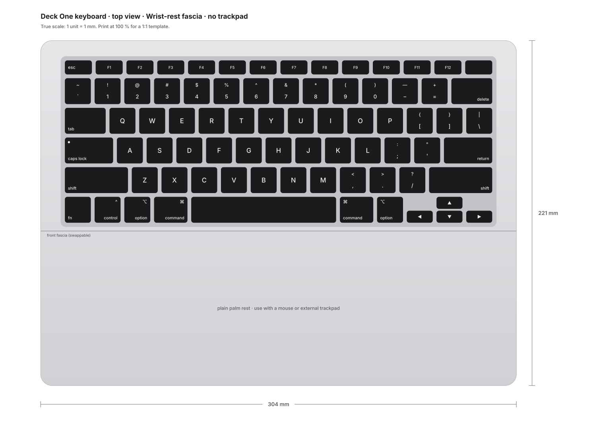
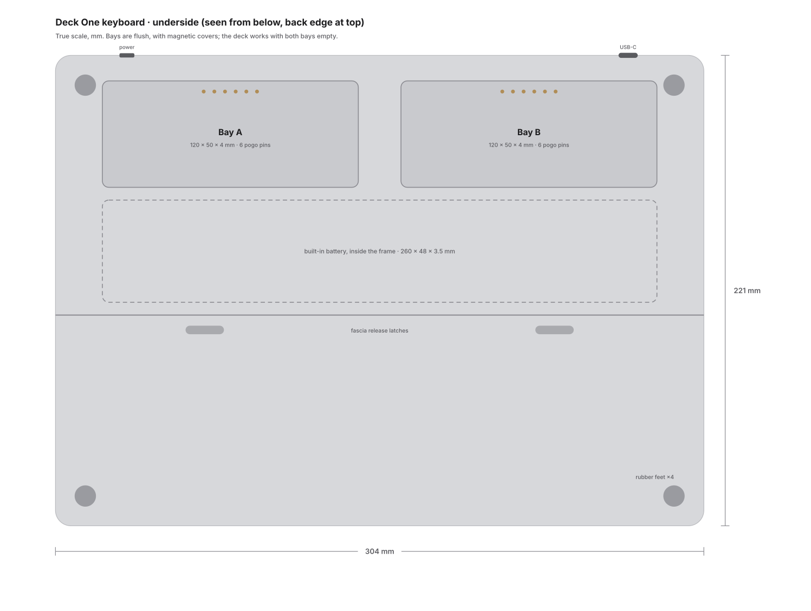
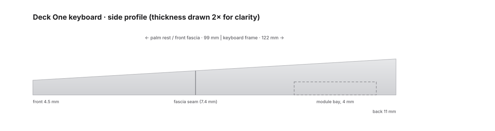

# Deck One keyboard

One slim slab: a thin-laptop keyboard and trackpad with its own battery. Modular **underneath** and **up front**, with nothing attached to the outside.


## What makes it different

- **One piece to carry.** Built-in battery, Bluetooth to three devices, USB-C. Use it on a desk, on your lap or on the sofa.
- **Modules underneath.** Two flush 4 mm bays in the base, each with a magnetic cover and a 6-pin pogo connector. The keyboard works with both bays empty. → [docs/underside-modules.md](docs/underside-modules.md)
- **Swappable palm rest (front fascia).** The front 99 mm of the keyboard is its own part. Choose the trackpad layout and material that suit your hands, and replace it when it wears. → [docs/fascia.md](docs/fascia.md)
- **Designed for big and sweaty hands.** A lower trackpad behind a thumb ridge, typing-aware palm rejection, a trackpad lock key, non-metal palm rests, PBT keycaps and a sealed layer under the keys. → [docs/fascia.md](docs/fascia.md#built-for-big-and-sweaty-hands)

## Palm-rest options

| Standard | Big hands | Wrist rest |
|---|---|---|
|  |  |  |
| 140 × 90 mm trackpad, 5.3 mm from the keys | 120 × 76 mm trackpad, 18.6 mm from the keys, 1 mm thumb ridge | no trackpad |

## Underside and profile





## Files

| Path | What |
|---|---|
| [`docs/spec.md`](docs/spec.md) | full specification |
| [`docs/keyboard-layout.md`](docs/keyboard-layout.md) | every row, key and unit size |
| [`docs/fascia.md`](docs/fascia.md) | palm-rest options, materials, big and sweaty hands |
| [`docs/underside-modules.md`](docs/underside-modules.md) | the two bays, the pogo pinout, module ideas |
| [`docs/build-guide.md`](docs/build-guide.md) | prototype one yourself |
| [`docs/design-notes.md`](docs/design-notes.md) | decisions, trade-offs, known limits |
| [`drawings/`](drawings/) | true-scale SVGs (1 unit = 1 mm): three top views, underside, side profile |
| [`data/`](data/) | position and size of all 78 keys, JSON and CSV |
| [`tools/generate_drawings.py`](tools/generate_drawings.py) | regenerates `drawings/` and `data/` |

```bash
cd keyboard
python3 tools/generate_drawings.py
```

## Known limits

- **Touch ID** only works with Apple's own keyboards. The fingerprint key works with hosts that accept an external reader, and maps to lock screen elsewhere.
- **macOS gestures:** macOS gives full multi-touch gestures to Apple trackpads only; a third-party trackpad usually gets pointer and scrolling. Windows and Linux support multi-touch trackpads natively.
- **Haptic glass trackpads** are hard to buy as standalone parts; prototypes will likely use a mechanical click.
