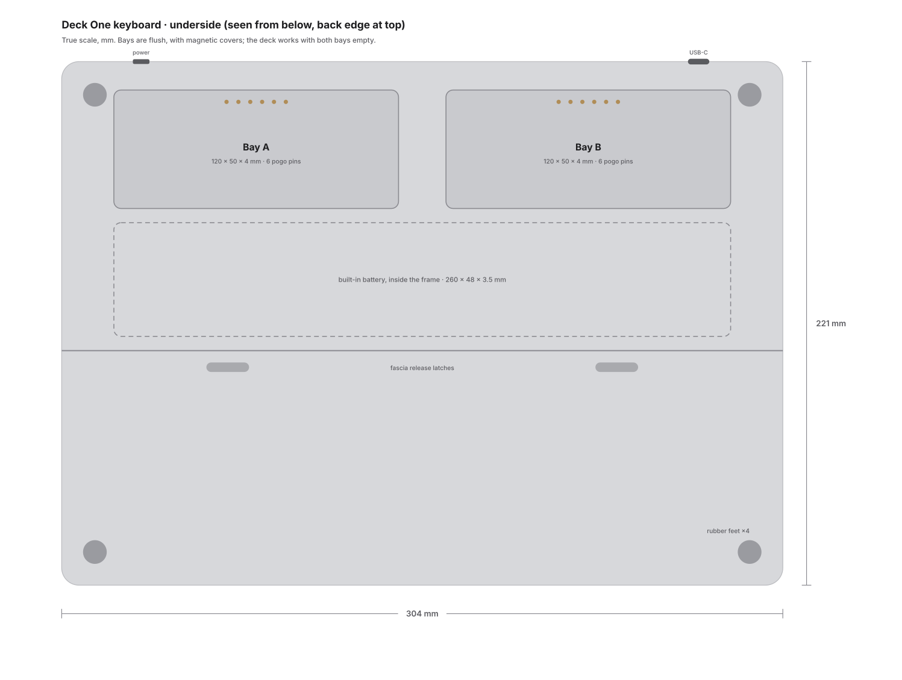

# Underside module bays

Two flush bays in the base of the keyboard, under the back rows of keys where the wedge is thickest. They keep the keyboard one slab: modules sit inside its outline, not on it. The keyboard works with both bays empty, because its own battery and radio are built in.

Drawing: [`../drawings/underside.svg`](../drawings/underside.svg)

## Bay dimensions

| Item | Value |
|---|---|
| Number | 2 (A and B, as labelled in the underside drawing, which is seen from below) |
| Outer size | 120 × 50 mm |
| Depth | 4 mm |
| Position | 12 mm from the back edge; 22 mm in from each side |
| Cover | flush aluminium or polymer, held by magnets; a module can be its own cover |

## Connector

Six pogo pins along the back edge of each bay, 5 mm pitch:

| Pin | Signal |
|---|---|
| 1 | VBUS (5 V, either direction) |
| 2 | GND |
| 3 | USB 2.0 D+ |
| 4 | USB 2.0 D− |
| 5 | ID (resistor to GND tells the keyboard which module is fitted) |
| 6 | spare / I²C data for simple modules |

Modules show up to the keyboard's controller as USB devices behind an internal hub, so a module can talk to the host computer through the keyboard's own connection.

## Module ideas

| Module | What it does |
|---|---|
| **Extra battery cassette** | Adds capacity on top of the built-in battery. Swap in a charged one without stopping. |
| **2.4 GHz receiver garage** | A low-latency wireless radio, with its USB receiver stored in the bay for travel. |
| **Security key bay** | Holds a hardware security key, connected inside over USB, so it's always with the keyboard. |
| **Maker module** | A blank module with the pinout broken out: sensors, macro pads, an e-ink status strip, your own board. |
| **Storage pocket** | No electronics: holds a short USB-C cable or adapter. |

## Rules for module makers

- Stay inside 120 × 50 × 4 mm, including the cover.
- Draw no more than 500 mA from VBUS.
- Use a unique ID resistor value (list yours in an issue so others don't clash).
- Batteries must have their own protection circuit.
