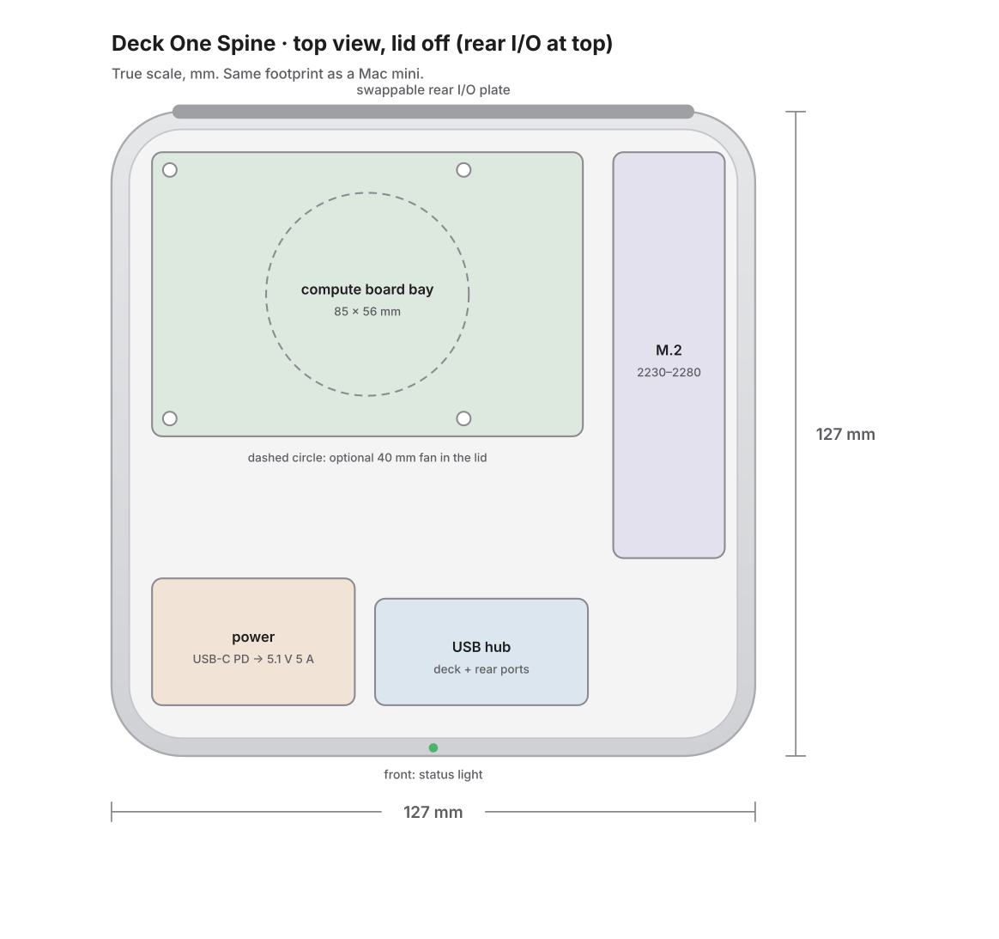
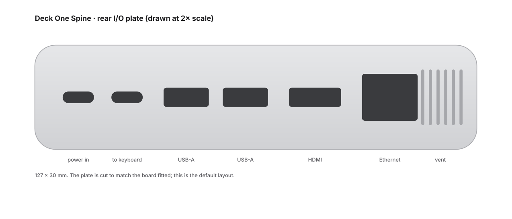

# Deck One Spine

A separate hub for the Deck One keyboard: a small aluminium box that holds the **compute board, storage and ports**, so the keyboard can stay a free, light slab. The two are joined by **one USB-C cable**, or not at all over Bluetooth.



## At a glance

- **127 × 127 × 30 mm**, the same footprint as a Mac mini, so it stacks neatly under one
- **Compute bay** for an 85 × 56 mm single-board computer (Raspberry Pi 4/5 size and similar) on standard M2.5 mounts, 58 × 49 mm apart
- **M.2 NVMe slot**, 2230 to 2280
- **USB-C PD power in**, regulated to the 5.1 V / 5 A a Raspberry Pi 5 needs
- **USB hub board:** the keyboard's cable plus the rear USB ports
- **Swappable rear I/O plate**, cut to match whichever board is fitted
- Vented lid, optional 40 mm fan, status light on the front



## Two modes

| Module | What the Spine becomes |
|---|---|
| **Compute** | A computer. A single-board computer sits in the bay; plug in a screen and the Deck One keyboard is its keyboard and trackpad. |
| **Dock** | A USB-C dock for a Mac mini or laptop. No board: the M.2 slot becomes a fast external drive, plus the rear ports. |

More in [docs/modules.md](docs/modules.md).

## Files

| Path | What |
|---|---|
| [`docs/spec.md`](docs/spec.md) | full specification |
| [`docs/modules.md`](docs/modules.md) | compute, dock and storage modules; the I/O plate |
| [`docs/build-guide.md`](docs/build-guide.md) | build one yourself |
| [`drawings/`](drawings/) | true-scale SVGs: internal top view, rear I/O |
| [`tools/generate_drawings.py`](tools/generate_drawings.py) | regenerates `drawings/` |

```bash
cd spine
python3 tools/generate_drawings.py
```

## Notes

- **Memory (RAM)** is soldered onto almost every single-board computer. On the Spine you upgrade it by swapping the board, not the RAM.
- The M.2 slot needs a board with a PCIe connection (a Raspberry Pi 5 with an M.2 adapter, for example) in Compute mode, or the dock's USB-to-NVMe bridge in Dock mode.
- The Spine is optional. The Deck One keyboard works with any computer on its own.
